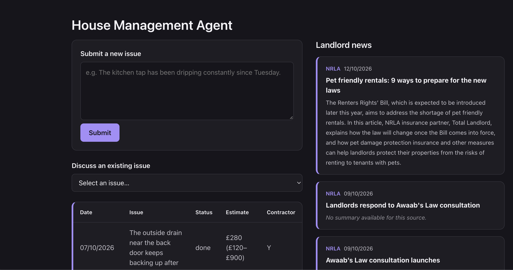

# House Management Agent

House Management Agent is an AI assistant for landlords, built to take the hassle out of
running a rental property. Report a maintenance issue and it researches repair costs,
finds contractors, or asks the right follow-up question — then stays in the conversation
so you can dig into an estimate, compare a quote, or ask for more options. It also keeps
you current with a news feed pulled from trusted landlord sources, all sitting behind
Google-account-only sign-in.



## What it does

- **Report and follow up on issues** — describe a maintenance problem and the agent
  researches repair costs local to your property, finds contractors, or asks a
  clarifying question, whichever the report actually needs, then keeps a conversation
  open so you can dig deeper afterwards.
- **Get cost estimates** — grounded in pricing for your property's location, with the
  option to pull a fresh comparison estimate during the follow-up conversation.
- **Find contractors** — surfaced alongside the estimate, or on request in conversation.
- **Stay current** — a landlord news feed built from trusted sources (NRLA, Tenancy
  Deposit Scheme), refreshed automatically every 2 days.
- **Gated access** — everything sits behind Google-account-only authentication, with
  Langfuse tracing and CI/CD to GCP Cloud Run.

## Running it locally

**Prerequisites:**
- Python 3.13, Node, and Docker
- An [OpenRouter](https://openrouter.ai/) account and API key (`OPENROUTER_API_KEY`) —
  required; the agent makes real LLM calls through it
- A [Langfuse](https://langfuse.com/) account and keys (`LANGFUSE_SECRET_KEY`,
  `LANGFUSE_PUBLIC_KEY`) — optional locally, used for tracing

```bash
docker compose up -d                  # Postgres 15 on localhost:5432 (repo root)

cd app/backend
python -m venv venv && source venv/bin/activate
pip install -r requirements.txt pytest
cp .env.example .env                  # fill in OPENROUTER_API_KEY; Langfuse keys optional locally
uvicorn main:app --reload --port 8000

# separate terminal
cd app/frontend
npm install
npm run dev                           # proxies /api/* to the backend in dev
```

## Running the tests

```bash
cd app/backend && source venv/bin/activate
python -m pytest tests                # unit tests — need docker compose up -d
python -m pytest -m eval tests/evals -s   # real LLM/web calls, costs money — run explicitly
```

```bash
cd app/frontend
npx vitest run
npx tsc -b
```

The backend test fixtures create and reset a `house_mgmt_test` database on the same
Postgres instance; without `docker compose up -d` the DB-backed tests fail with
connection errors.

## More context

- `ARCHITECTURE.md` — whole-system map: components, request flow, deploy flow
- `docs/decisions/` — ADRs for significant technical decisions
- `docs/specs/` — technical specs for individual build slices
- `docs/prds/production-v1-prd-200926.md` — the production v1 PRD
- `docs/status_docs/` — session notes and planning
- `prototypes/` — throwaway loop experiments (`prototypes/README.md`), not production code
- `infra/` — Terraform; see `infra/README.md` for the bootstrap sequence
